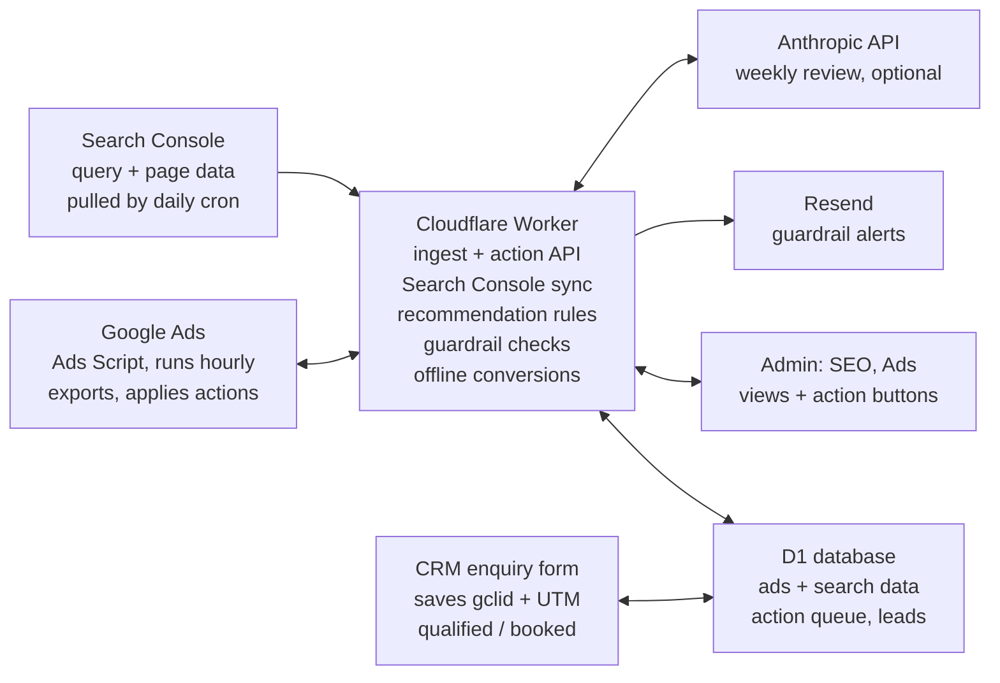

# Moments in Light — Ads & SEO Command Centre Spec

Oct 18, 2026 · Tony

## Purpose and scope

Add an Ads section inside the existing SEO admin area of the Astro site. It pulls Google Ads and Search Console data into D1 every night. It shows where ad spend overlaps with organic rankings, and it sends approved changes back to Google Ads. The goal is to cut wasted spend and steadily shift budget from ads to SEO.

In scope:

- Nightly Google Ads data import via a Google Ads Script. No Google Ads API developer token is needed.
- Search Console query and page data via the Search Console API.
- Enquiry attribution through the new CRM enquiry form: gclid, UTM, and landing page are stored on each lead.
- Recommendations comparing ads with organic results, flagging wasted search terms, and finding content gaps.
- Two-way control: actions approved in the dashboard are queued, and the Ads Script applies them on its next run.
- Spend guardrails with email alerts through Resend.
- An optional weekly AI summary.

Out of scope for v1: Meta ads, Microsoft Ads, bid-strategy automation, and creating new campaigns from the dashboard.

## Architecture

Everything runs on the existing Cloudflare stack, and the only Google-side code is one Ads Script.

The Ads Script both exports data and applies queued actions, so Google Ads never needs to call the site and no Ads API token is required.

## Data model (D1)

All Ads tables are keyed by date, so each import is idempotent: the script re-sends the last 30 days every night and upserts them, because Google revises conversions after the fact. Money is stored in NZD cents as integers.

| Table | Grain | Key columns |
| --- | --- | --- |
| ads_campaign_daily | campaign × day | date, campaign_id, name, status, channel_type, budget_cents, cost_cents, impressions, clicks, conversions, search_impression_share, lost_is_budget |
| ads_keyword_daily | keyword × day | date, campaign_id, ad_group_id, criterion_id, text, match_type, status, quality_score, cost_cents, clicks, conversions, avg_cpc_cents |
| ads_search_term_daily | search term × day | date, campaign_id, ad_group_id, search_term, matched_keyword, cost_cents, clicks, conversions |
| ads_negative | negative keyword | level (campaign/shared_list), list_or_campaign_id, text, match_type, source (manual/dashboard) |
| gsc_query_daily | query × page × day | date, query, page, clicks, impressions, ctr, position |
| keyword_map | normalised term | term, target_page, intent (brand/venue/location/generic/junk), notes. This table joins Ads and Search Console. |
| ads_action | queued change | id, type, payload_json, status (pending/applied/failed/cancelled), created_at, applied_at, error |
| ads_import_log | script run | run_at, rows_received, ok, error |
| guardrail | rule | metric, threshold, window_days, action (alert/pause), enabled |

Leads stay in the CRM's own tables. Add these attribution columns to the lead record: gclid, gbraid, wbraid, utm_source, utm_medium, utm_campaign, utm_term, landing_page, first_seen_at, and booked_value_cents. A table called offline_conversion_queue (lead_id, gclid, action_name, conversion_time, value_cents, sent_at) feeds conversion uploads to Google Ads. A view, v_lead_attribution, joins leads to campaigns by utm_campaign or by gclid click date.

## Google Ads Script

One script, pasted into Google Ads under Tools > Bulk actions > Scripts, does both directions. It runs hourly and only exports once a day. The script source lives in the repo at /scripts/google-ads/sync.js so changes are versioned, and Tony pastes updates in by hand.

Each run:

1. Fetches GET /api/ads/actions. For each pending action it applies the change and reports back to POST /api/ads/actions/:id/result with applied or failed and an error message.
2. Checks the guardrail rules from GET /api/ads/guardrails against today's spend. It pauses campaigns if a rule's action is pause.
3. Once a day, after 3am NZT, it runs GAQL reports through AdsApp.search() for the last 30 days: campaign, keyword_view, search_term_view, and shared and campaign negatives. It POSTs them in chunks of no more than 1,000 rows to /api/ads/ingest.
4. If enabled, it uploads offline conversions from GET /api/ads/offline-conversions (see the attribution section).

Supported action types for v1:

- add_negative: text, match_type, scope (a campaign or the shared list called MIL Negatives)
- pause_keyword and enable_keyword: criterion_id
- set_campaign_budget: campaign_id, amount_cents
- pause_campaign and enable_campaign: campaign_id

Safety rules: the script refuses any budget increase above a cap that is set in the script itself, not in the dashboard. It logs every change with Logger, and it never deletes anything.

## Worker API and auth

The Ads Script calls the endpoints marked "script" below. It authenticates with a long random bearer token stored as the Worker secret ADS_SYNC_TOKEN, and it also sends an HMAC-SHA256 signature of the request body in the X-Signature header. Endpoints marked "admin" sit behind the site's existing admin auth. Put Cloudflare Access in front of /admin and /api/admin if they aren't already protected.

| Method + path | Caller | Purpose |
| --- | --- | --- |
| POST /api/ads/ingest | script | Upserts a chunk of report rows. The body is { report, rows[] }. |
| GET /api/ads/actions | script | Returns pending actions. |
| POST /api/ads/actions/:id/result | script | Marks an action applied or failed. |
| GET /api/ads/guardrails | script | Returns the enabled guardrail rules. |
| GET /api/ads/offline-conversions | script | Returns new qualified and booked leads with a gclid. |
| GET /api/admin/ads/overview | admin | Returns dashboard data for a date range. |
| POST /api/admin/ads/actions | admin | Queues an action from a dashboard button. |
| DELETE /api/admin/ads/actions/:id | admin | Cancels an action that is still pending. |
| PUT /api/admin/keyword-map | admin | Edits the intent or target page for a term. |

Rate-limit the script endpoints, and reject any request whose body is over 2 MB. A Cron Trigger runs the Search Console sync and the guardrail checks.

## Search Console sync

If the site's existing SEO section already stores Search Console data, reuse that table and skip this section. Claude Code should check this first.

Otherwise, a Worker Cron Trigger runs daily at 05:00 NZT. It calls the Search Analytics API (searchanalytics.query) for momentsinlight.co.nz with the query and page dimensions, re-pulling the last 10 days because Search Console data lags 2–3 days. It authenticates as a Google Cloud service account that has been added as a user on the Search Console property. The service-account JSON is stored as the Worker secret GSC_SA_KEY and signed into a JWT with WebCrypto, so no Node SDK is needed.

Normalise queries before joining them to Ads: lowercase, trim, collapse whitespace, and strip the words "nz" and "new zealand" only when matching. Exact-match joins come first, then a fuzzy match on token overlap of at least 0.8, which is shown as "approximate" in the UI.

## Enquiry attribution

The CRM enquiry form makes cost per enquiry and cost per booking measurable, and it lets Google optimise for bookings rather than clicks.

1. **Capture.** A small script on every page reads gclid, gbraid, wbraid, and the utm_* parameters from the URL. It stores them first-party in a cookie called mil_attr for 90 days, along with the landing page and a first-seen timestamp. The script doesn't overwrite an existing gclid with an empty one.
2. **Submit.** The enquiry form sends the mil_attr values in hidden fields, and the CRM saves them on the lead.
3. **Auto-tagging.** Turn on auto-tagging in Google Ads, and set the final URL suffix to utm_source=google&utm_medium=cpc&utm_campaign={campaignid}&utm_term={keyword}.
4. **Offline conversions.** In Google Ads, create two conversion actions with the import source set to "clicks": MIL Qualified Enquiry and MIL Booking. When the CRM moves a lead to qualified or booked, it writes a row to offline_conversion_queue (gclid, action name, time with timezone, value). The Ads Script uploads these with AdsApp.bulkUploads() using the offline-conversion CSV format, then marks them sent.
5. **Switch primary.** Once 30 or more uploaded conversions exist, set MIL Qualified Enquiry as the primary conversion and demote raw form submits to secondary.

Privacy: add a line to the privacy policy covering ad-click IDs. Store no IP addresses.

## Dashboard views

All views live under /admin/seo/ads, with a date-range picker (7, 30, or 90 days) and NZD throughout. Every row whose recommendation is an action gets a button that queues it, and pending actions show a "queued, applies within the hour" badge.

| View | Shows | Action buttons |
| --- | --- | --- |
| Overview | Spend, enquiries, bookings, cost per enquiry, cost per booking, organic clicks vs paid clicks, and wasted spend this period | None |
| Ads vs organic | Each paid keyword with its spend, clicks, enquiries, organic position, organic clicks, and a recommendation | Pause keyword, keep, or create page brief |
| Wasted search terms | Search terms with cost above $0 and no enquiries, sorted by cost. Junk-pattern matches are highlighted. | Add negative (exact or phrase, campaign or shared list) |
| Content gaps | Paid keywords with real spend and no page ranking in the top 20 | Create page brief, which saves a draft blog or landing page outline in the CMS |
| Campaigns | Campaign type, budget, spend, impression share, budget-lost share, and cost per enquiry | Pause, enable, or set budget |
| Enquiries | Leads with their source, campaign, keyword, landing page, and status | None |
| Action log | Every queued action with its status and any error | Cancel a pending action |
| Settings | Guardrails, the junk-term list, keyword intents, and the script's last run | Edit |

The overview also carries a health strip that turns red when the last script import is more than 26 hours old, when the Search Console sync has failed, or when a guardrail has been breached.

## Recommendation rules

The core rule is to pay only where organic results can't win yet. Rules are evaluated per normalised term over the selected window, first match wins. Thresholds live in Settings so Tony can tune them.

| # | Condition | Recommendation |
| --- | --- | --- |
| 1 | The term matches the junk list (for example free, cheap, diy, course, jobs, photo booth) | Add as a negative |
| 2 | Search term cost is $40 or more with 0 enquiries in 90 days | Add as a negative (phrase match) |
| 3 | Brand term with an organic position of 1.5 or better, and impression share shows no competitor ads | Pause the brand keyword, then watch enquiries for 14 days |
| 4 | Organic position of 3 or better, and organic clicks at least equal to paid clicks | Pause or reduce: you're paying for clicks you already get |
| 5 | Organic position from 3.1 to 20 | Keep the ad, and flag the page to improve |
| 6 | No page in the top 20, with intent set to venue, location, or generic | Keep the ad, and create a page brief (content gap) |
| 7 | Keyword cost per enquiry is more than 2× the account average, after 10 or more clicks | Reduce the bid or pause |
| 8 | Campaign type is Display, Performance Max, or Smart, or Search Partners is on, with no enquiries in 30 days | Pause the campaign or switch the setting off |
| 9 | Anything else | No action |

Each recommendation shows its reason in plain words, for example: "Ranks #2 organically; 64% of this term's clicks were already free."

## Guardrails and alerts

Guardrails stop a bad day from becoming a bad month. The Ads Script enforces pause rules hourly, and a Worker cron sends alerts by email through Resend.

| Rule (defaults, editable) | Action |
| --- | --- |
| Today's spend is over 1.5× the daily budget | Alert |
| Month-to-date spend is over the monthly cap Tony sets | Pause all campaigns and alert |
| Rolling 14-day spend is $150 or more with 0 enquiries | Alert with the top 5 cost search terms |
| 7-day cost per enquiry is over 2× the 90-day average | Alert |
| No script import for more than 26 hours | Alert |

Alerts link straight to the relevant dashboard view. Send at most one email per rule per day.

## Weekly AI review (optional)

Every Monday at 07:00 NZT, a Worker cron sends the week's aggregates to the Anthropic Messages API. The aggregates include the top 50 search terms, the keyword-vs-organic table, enquiries, and guardrail events; no personal lead details are sent. The prompt asks for at most 5 recommended actions in JSON, each tied to a rule above or explained if it is new.

The results appear as suggestions in the dashboard, each with its own queue button, and in a short Resend email. Nothing is applied without Tony clicking. The Anthropic API key is stored as a Worker secret.

## Build phases

Build in this order. Each phase is useful on its own, so the spend fixes can start after phase 2.

1. **Data in.** Build the D1 migrations, the ingest endpoint, the Ads Script export, and the Search Console sync. *Done when* 90 days of campaign, keyword, and search-term data match the totals in the Google Ads UI to within 1%.
2. **Read-only dashboard.** Build the Overview, Ads vs organic, Wasted search terms, Content gaps, and Campaigns views, plus the recommendation rules. *Done when* every rule fires correctly on seeded test data, and the views load in under 1 second.
3. **Two-way control.** Build the action queue, the script action handler, the action buttons, and the Action log. *Done when* adding a negative from the dashboard appears in Google Ads within one hour, and a failed action shows its error.
4. **Attribution.** Build gclid and UTM capture, the CRM fields, the Enquiries view, and the offline-conversion upload. *Done when* a test enquiry from a tagged URL appears with its campaign, and a booking shows up as a conversion in Google Ads within 24 hours.
5. **Guardrails and AI review.** Build the guardrail checks, Resend alerts, and the Monday review. *Done when* a simulated spend breach sends one email and the pause rule pauses campaigns.

Add tests for the rules engine, query normalisation, and the HMAC check. Keep the Ads Script's GAQL queries in one place so they're easy to update when Google changes its API version.

## Setup checklist and limits

Tony will need to do these steps by hand, because Claude Code can't:

- [ ] Turn on auto-tagging in Google Ads, and set the final URL suffix
- [ ] Create the MIL Qualified Enquiry and MIL Booking conversion actions (import from clicks)
- [ ] Create a Google Cloud service account, and add it as a user on the Search Console property
- [ ] Add the Worker secrets: ADS_SYNC_TOKEN, ADS_HMAC_KEY, GSC_SA_KEY, RESEND_API_KEY, ANTHROPIC_API_KEY
- [ ] Paste the Ads Script into Google Ads, authorise it, and schedule it hourly
- [ ] Set the monthly spend cap and the script's budget-increase cap
- [ ] Add the shared negative keyword list called MIL Negatives

Known limits:

- Ads data lags about 3 hours, and Search Console data lags 2–3 days.
- Google hides low-volume search terms, so some spend won't appear in the search terms report.
- Performance Max and Smart campaigns give very little keyword detail. Rule 8 treats them with suspicion for that reason.
- Ads Scripts time out after 30 minutes and allow about 50,000 changes per run, which is far more than this account needs.
- Pausing brand ads can let competitors take the top spot. Rule 3 checks impression share first, and the dashboard should be watched for 14 days after any brand pause.
